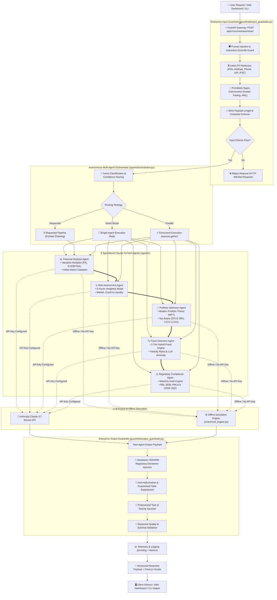

# 🏦 FinSphere AI — Autonomous FinTech Multi-Agent Platform

> **Next-Generation Autonomous Multi-Agent Financial Intelligence Platform**  
> Engineered for Indian Startups & Global Markets with Enterprise Guardrails, Dynamic Risk Weighting, and Statutory Compliance.

[](https://www.python.org/downloads/)
[](https://fastapi.tiangolo.com)
[](https://docs.pydantic.dev/)
[](LICENSE)
[]()
[](https://github.com)

---

## 📖 Table of Contents
- [Architecture](#architecture)
- [Key Features](#key-features)
- [The 5 Specialized Agents](#the-5-specialized-agents)
- [Enterprise Guardrails](#enterprise-guardrails)
- [Customizable Parameters](#customizable-parameters)
- [Quickstart Guide](#quickstart-guide)
- [Institutional Web Dashboard](#institutional-web-dashboard)
- [Command-Line Interface (CLI)](#command-line-interface-cli)
- [API Reference & Examples](#api-reference--examples)
- [Running Tests](#running-tests)
- [Docker Deployment](#docker-deployment)
- [Author & License](#author--license)

---

## Architecture



---

## Key Features

1. **Autonomous Multi-Agent Collaboration**: Run agents standalone, chained as a sequential pipeline (where each agent's output enriches the next agent's context), or in parallel.
2. **Offline Simulation Mode**: Features a built-in mock engine (`core/mock_engine.py`) so you can test all agents, routes, CLI commands, and UI controls **without paying for an API key**. Seamlessly activates live Anthropic Claude models when you supply your key.
3. **Indian FinTech Specialization**:
   - Automated redaction for Indian PII: **PAN Cards**, **Aadhaar Numbers**, **Indian Mobile Numbers (+91)**, **UPI VPA Handles**, and **Bank IFSC Codes**.
   - Built-in alignment with **RBI Digital Lending Guidelines**, **SEBI LODR**, **PMLA 2002 STR/CTR**, **FEMA 1999**, and **DPDP Act 2023**.
   - Tax-aware portfolio modeling: **STCG (20%)** and **LTCG (12.5%)** per latest Indian Union Budget updates.
4. **Centralized Parameter Customization**: Every risk weight, economic indicator, high-value fraud limit, velocity window, and portfolio threshold is configurable via `.env` or `core/config.py`.
5. **Institutional Web Dashboard**: High-end Bloomberg/Linear-style interactive web interface with live Chart.js visualizations, 5-step pipeline stepper, and guardrail test arena.
6. **Production-Ready**: Multi-stage `Dockerfile`, `docker-compose.yml`, structured logging with `structlog`, and 39 automated unit & integration tests.

---

## The 5 Specialized Agents

| Agent | Responsibility | Claude Tools / Structured Schema |
|---|---|---|
| **📊 Financial Analysis** | Fundamental equity research, valuation multiples (P/E, P/B, EV/EBITDA), revenue growth, Indian macro catalysts | `extract_financial_metrics` |
| **⚠️ Risk Assessment** | 5-dimension weighted risk evaluation: Market (30%), Credit (25%), Liquidity (20%), Regulatory (15%), Operational (10%) | `score_risk` |
| **💼 Portfolio Optimizer** | Modern Portfolio Theory (MPT) allocation across Indian equities, G-Secs, SGB/Gold, US FoF, and REITs with tax impact | `suggest_allocation` |
| **🔍 Fraud Detection** | 2-Tier hybrid engine: High-throughput deterministic heuristics (velocity, limit, night hours) + Deep LLM anomaly reasoning | `flag_transactions` |
| **⚖️ Regulatory Compliance** | Automated statutory audit against RBI, SEBI, PMLA, FEMA, and DPDP Act 2023 requirements | `compliance_check` |

---

## Enterprise Guardrails

### Input Defense
* **Prompt Injection Blocking**: Intercepts 15+ patterns including role escape, token injection, and system prompt dump attempts.
* **Prohibited Financial Topics**: Hard-blocks requests concerning insider trading, pump-and-dump, wash trading, tax evasion, and money laundering.
* **PII Sanitization**: Auto-masks Indian PAN, Aadhaar, Mobile, UPI handles, IFSC codes, US SSN, credit cards, and email addresses.
* **Payload Length Enforcer**: Validates requests within configurable character thresholds (default: 8,000 chars).

### Output Defense
* **Regulatory Disclaimer Enforcement**: Guarantees inclusion of SEBI/RBI disclaimer for all advisory outputs.
* **Hallucination & Guarantee Blocker**: Intercepts claims of guaranteed returns, 100% safe yields, or over-precise fabricated projections.
* **Toxicity Filter**: Blocks unprofessional, offensive, or harmful agent outputs.

---

## Customizable Parameters

All parameters are managed in `.env` (copy from `.env.example`). Key parameters include:

```ini
# Model & Execution
ANTHROPIC_API_KEY=""                # Optional: Leave blank to use offline Simulation Mode
MODEL="claude-3-7-sonnet-20250219"  # claude-3-7-sonnet-20250219, claude-3-5-sonnet, claude-3-haiku
MOCK_MODE=false                     # Force simulation mode

# Currency & Taxes
BASE_CURRENCY="INR"
USD_TO_INR_RATE=86.50
STCG_TAX_RATE=0.20                  # Indian STCG Tax (20%)
LTCG_TAX_RATE=0.125                 # Indian LTCG Tax (12.5%)
RISK_FREE_RATE=0.07                 # 10Y G-Sec yield (7.0%)

# Fraud Rules Engine
HIGH_AMOUNT_THRESHOLD_INR=100000.0  # Immediate fraud review threshold (₹1,00,000)
VELOCITY_WINDOW_MINUTES=5           # Sliding window (minutes)
MAX_TRANSACTIONS_IN_VELOCITY_WINDOW=3

# Risk Factor Weights
MARKET_RISK_WEIGHT=0.30
CREDIT_RISK_WEIGHT=0.25
LIQUIDITY_RISK_WEIGHT=0.20
REGULATORY_RISK_WEIGHT=0.15
OPERATIONAL_RISK_WEIGHT=0.10
```

---

## Quickstart Guide

### 1. Set Up Virtual Environment & Dependencies
```bash
python3 -m venv .venv
source .venv/bin/activate
pip install -r requirements.txt
```

### 2. Configure Environment
```bash
cp .env.example .env
# Optional: Add your ANTHROPIC_API_KEY if you want live Claude calls
```

### 3. Start the Server
```bash
python main.py
```
Open your browser:
* **Institutional Dashboard:** [http://localhost:8000/dashboard](http://localhost:8000/dashboard)
* **Swagger API Explorer:** [http://localhost:8000/docs](http://localhost:8000/docs)
* **Health Endpoint:** [http://localhost:8000/health](http://localhost:8000/health)

---

## Institutional Web Dashboard

FinSphere AI includes a built-in institutional Web UI at `http://localhost:8000/dashboard`:
* **Interactive Financial Charts (Chart.js)**:
  - **Portfolio Donut Chart**: Visual asset allocation breakdown across Indian Equities, G-Secs, Gold SGB, and US FoF.
  - **5-Factor Risk Radar Chart**: Quantifies Market, Credit, Liquidity, Regulatory, and Operational exposures.
  - **Fraud Probability Bar Chart**: Color-coded risk scoring per transaction (Green = Clean, Amber = Review, Red = Blocked).
* **5-Step Execution Pipeline Topology**: Live glowing stepper tracking `Input Guard` &rarr; `Intent Router` &rarr; `Agent Execution` &rarr; `Output Guard` &rarr; `Structured Output`.
* **Guardrails Live Sandbox**: Interactive test arena to test real-time masking of Indian PAN, Aadhaar, UPI, and Phone numbers.
* **System Parameter Studio**: Live inspection of economic indicators, risk weights, tax rates, and fraud rules.
* **1-Click Test Presets**: Pre-populated realistic financial prompts for instant evaluation.

---

## Command-Line Interface (CLI)

Use `cli.py` to run queries directly from your terminal:

```bash
# Run full automated demo across all 5 agents
python cli.py demo

# View active system parameters & weights
python cli.py config

# Smart Query (Auto-routes to the best agent)
python cli.py query "Analyze Tata Motors earnings growth and valuation"

# Run Equity Fundamental Analysis
python cli.py analyze --ticker TATAMOTORS --timeframe 1Y

# Run Quantitative Risk Assessment
python cli.py risk --asset "High-Yield NBFC Unsecured Commercial Paper"

# Run Portfolio Optimization
python cli.py portfolio --capital 5000000 --risk moderate --years 5

# Scan Sample Transactions for Fraud
python cli.py fraud

# Run Regulatory Compliance Audit
python cli.py compliance --text "Sample customer onboarding agreement without explicit DPDP opt-out clause"
```

---

## API Reference & Examples

### 1. Autonomous Smart Routing
Auto-classifies intent and selects the optimal agent:
```bash
curl -X POST http://localhost:8000/api/v1/query/ \
  -H "Content-Type: application/json" \
  -d '{"query": "Analyze HDFC Bank fundamental multiples and revenue growth"}'
```

### 2. Sequential Multi-Agent Pipeline
Chains agents in sequence, forwarding prior outputs as downstream context:
```bash
curl -X POST http://localhost:8000/api/v1/query/ \
  -H "Content-Type: application/json" \
  -d '{
    "query": "Should I invest ₹50 lakhs in Nifty 50 and G-Secs?",
    "pipeline": ["financial_analysis", "risk_assessment", "portfolio"]
  }'
```

### 3. Transaction Fraud Screening
```bash
curl -X POST http://localhost:8000/api/v1/fraud/ \
  -H "Content-Type: application/json" \
  -d '{
    "transactions": [
      {
        "transaction_id": "TXN_IND_8901",
        "amount_inr": 125000,
        "merchant": "Luxury Retail Mumbai",
        "location": "Mumbai, India",
        "user_id": "USR_99",
        "channel": "UPI"
      }
    ]
  }'
```

### 4. Regulatory Compliance Audit
```bash
curl -X POST http://localhost:8000/api/v1/compliance/ \
  -H "Content-Type: application/json" \
  -d '{
    "document_text": "FinTech partner routes borrower loan repayments through an intermediary escrow account before settling with the NBFC.",
    "regulation_context": "RBI Digital Lending Guidelines, DPDP Act 2023"
  }'
```

---

## Running Tests

Run the full pytest suite (no API key required):
```bash
pytest tests/ -v
```
**Results:** `39 passed in ~0.56s` (100% pass rate).

---

## Docker Deployment

Build and run using Docker:
```bash
# Build image
docker build -t finsphere-ai .

# Run container
docker run -p 8000:8000 --env-file .env finsphere-ai

# Or with Docker Compose
docker-compose up -d
```

---

## 👨‍💻 Author

<div align="center">

<a href="https://github.com/iitking">
  
</a>

### **Nivesh Kumar Meena**

**AI Architect · MLOps Engineer** | B.Tech Electrical Engineering, **IIT Roorkee**

*Building agentic AI systems, RAG pipelines and production-ready ML.*

<a href="https://www.linkedin.com/in/nivesh-kumar-meena-a31465221/"></a>
<a href="https://github.com/iitking"></a>
<a href="mailto:niveshkr149@gmail.com"></a>

<br/><br/>

⭐ **If you found this project useful, please give it a star!** ⭐

<sub>Open to AI/ML engineering opportunities and collaborations.</sub>

</div>

---

<div align="center">
  <sub>Made with ❤️ by <a href="https://github.com/iitking">Nivesh Kumar Meena</a> · © 2026 · MIT License</sub>
</div>
